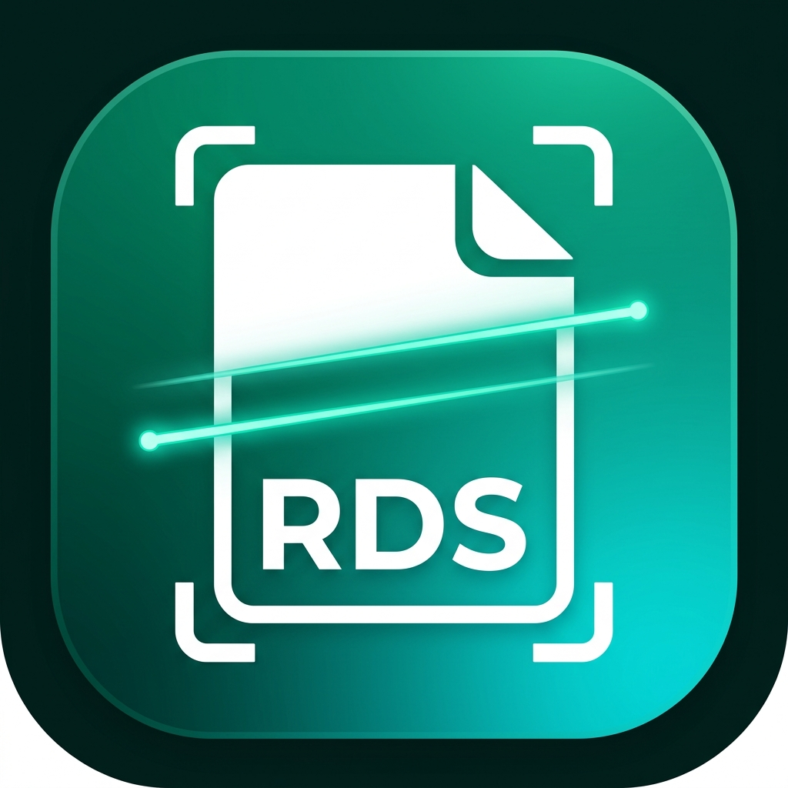

# RDS SCANNER — Smart Document Scanner, OCR & PDF Maker

<p align="center">
  
</p>

<p align="center">
  <b>A Privacy-First, 100% Free & Open-Source CamScanner Alternative for Android</b><br>
  <i>Developed with ❤️ by <b><a href="https://github.com/Sami12901">Sami</a></b></i>
</p>

<p align="center">
  <a href="https://github.com/Sami12901/RDS-SCANNER/releases/latest"></a>
  <a href="LICENSE"></a>
  
  
  
  
  
</p>

---

## 📥 Download RDS SCANNER APK

Get the latest version directly for your Android phone:

<p align="center">
  <a href="https://github.com/Sami12901/RDS-SCANNER/releases/latest/download/RDS-SCANNER-v1.0.0.apk">
    
  </a>
</p>

> Or view all release files on the **[Releases Page](https://github.com/Sami12901/RDS-SCANNER/releases)**.

---

## 🌟 Why RDS SCANNER?

Commercial scanner apps like CamScanner come with intrusive advertisements, costly monthly subscriptions, forced watermarks on free PDFs, and privacy concerns from uploading your documents to third-party servers.

**RDS SCANNER** solves all of that:

| Feature | CamScanner (Commercial) | RDS SCANNER (Open Source by Sami) |
| :--- | :--- | :--- |
| **Document Scanning** | Auto edge detection, auto-capture | **Google ML Kit Document Scanner** + CameraX |
| **Edge Crop & Perspective** | Manual/Auto 4-point adjustment | Automated 4-point perspective warp & de-skew |
| **Enhancement Filters** | "Magic Color", B&W, Grayscale | **Custom Magic Color**, Grayscale, B&W Threshold, Original |
| **PDF Watermarks** | Forced "Scanned with CamScanner" | **100% Clean PDF (Zero Watermark)** |
| **OCR (Text Extraction)** | Paid tier / Cloud upload | **100% On-Device ML Kit OCR (Offline & Instant)** |
| **ID Card & Passport Mode** | Dual-side stitch to single page | Built-in Front + Back card stitcher onto A4 sheet |
| **Digital Signature** | Paid feature | Built-in finger/stylus signature pad |
| **Privacy & Security** | Data uploaded to cloud servers | **100% Local On-Device Storage (Zero Telemetry)** |
| **Advertisements** | Heavy banner, interstitial & popups | **100% Ad-Free & Subscription-Free** |

---

## 🚀 Key Features

### 1. 📷 Smart Document Scanner
- **Auto Edge Detection**: Detects paper edges and aligns them automatically.
- **Perspective Dewarp**: Fixes angled shots and flattens paper.
- **Multi-page Scanning**: Scan books, contracts, or receipts in bulk.
- **Gallery Import**: Convert existing photos and images into scanned documents.

### 2. 🎨 Enhancement Filters
- **Magic Color**: CamScanner's trademark look — whitens paper background, strengthens ink, and enhances clarity.
- **B&W / Monochrome**: High-contrast document thresholding for crisp printing and tiny file size.
- **Grayscale**: Clean monochrome rendering for forms and sketches.
- **Original**: Keeps the photo unaltered.

### 3. 🆔 ID Card & Passport Dual-Sided Mode
- Captures Front and Back of an ID card, Driving License, or Passport.
- Automatically stitches both sides onto a single, printable standard A4 sheet with clean margins and labels.

### 4. 🔤 On-Device OCR (Text Extraction)
- Offline text recognition powered by Google ML Kit.
- One-tap text copying to clipboard and direct sharing as plain text.

### 5. ✍️ Digital Signature & Annotations
- Draw your signature directly with your finger or stylus in black, blue, or emerald ink.
- Stamp the signature onto any page before generating your PDF.

### 6. 📄 Clean PDF Generator & Sharing
- Native Android `PdfDocument` engine for fast, memory-safe compilation.
- Multiple quality and compression options.
- One-tap direct sharing to WhatsApp, Gmail, Telegram, Google Drive, or Print.

---

## 📲 How to Install the APK on Android

1. Download [`RDS-SCANNER-v1.0.0.apk`](https://github.com/Sami12901/RDS-SCANNER/releases/latest/download/RDS-SCANNER-v1.0.0.apk) on your Android device.
2. Tap the downloaded file in your browser or File Manager.
3. If prompted with *"For your security, your phone is not allowed to install unknown apps from this source"*, tap **Settings** and enable **"Allow from this source"**.
4. Tap **Install** and open **RDS SCANNER**!

---

## 🛠️ Architecture & Tech Stack

```
RDS SCANNER Architecture
├── UI Layer           Jetpack Compose + Material 3 (Material You)
├── Navigation         Navigation3 Compose Runtime
├── Scanner Engine     Google Play Services ML Kit Document Scanner
├── OCR Engine         Google ML Kit Text Recognition (100% Offline)
├── Image Processing   Custom Bitmap Filters (Magic Color, B&W, ID Stitch)
├── PDF Engine         Native Android PdfDocument (Memory-Safe)
├── Storage            Local App-Specific Directory + JSON Metadata
└── Build System       Gradle 9.1 + AGP 9.0.1 + Java 21
```

---

## 💻 How to Build from Source

### Prerequisites
- JDK 17 or JDK 21 (bundled in Android Studio)
- Android SDK (API 24 to 36)

### Clone & Build
```bash
# Clone the repository
git clone https://github.com/Sami12901/RDS-SCANNER.git
cd RDS-SCANNER

# Build debug APK
./gradlew assembleDebug

# Output APK path:
# app/build/outputs/apk/debug/app-debug.apk
```

### Install via ADB:
```bash
adb install -r app/build/outputs/apk/debug/app-debug.apk
```

---

## 👨‍💻 Author & Credits

- **Application Name:** RDS SCANNER
- **Developed by:** **[Sami](https://github.com/Sami12901)** (`Develop by Sami`)
- **License:** [Apache License 2.0](LICENSE) — Free & Open Source for everyone.

---

<p align="center">
  <b>If you love RDS SCANNER, don't forget to give this repository a ⭐ star!</b>
</p>
